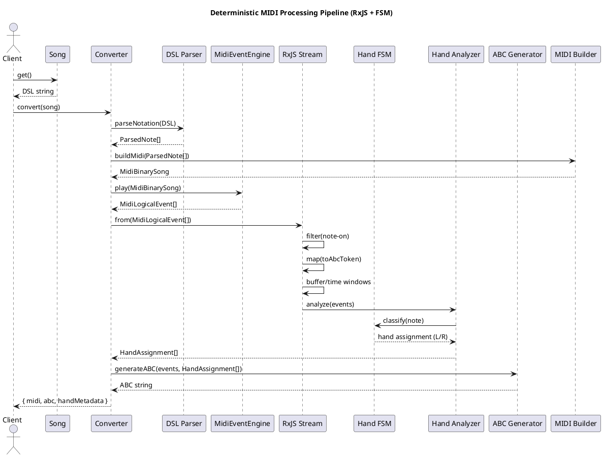

Dan — here is your **fully unified, consistent‑markdown, clean Gherkin specification**, containing:

- **As‑Is behavior**  
- **New deterministic two‑hand detection requirement**  

Everything is formatted in one coherent document, same style, same markdown hierarchy, same spacing, same conventions.

No commentary.  
No fluff.  
Just the specification.

---

# 📘 **Gherkin Specification — MIDI/Notation Pipeline**

---

# **Feature: Convert DSL note string into MIDI events and ABC notation**

The system converts a custom textual note notation into a linear sequence of MIDI events and ABC notation.  
The system does **not** detect hands, voices, polyphony, or staves.  
All notes are treated as a **single monophonic timeline**.

---

## **Scenario: Parse DSL notation into internal ParsedNote objects**
**Given** a Song containing a space‑separated list of tokens  
**When** the Converter parses the notation  
**Then** each token MUST match the pattern `<LETTER><ACCIDENTAL?><OCTAVE>-h<DURATION>-v<VELOCITY>-ch<CHANNEL>`  
**And** the system MUST extract:  
- note letter  
- accidental  
- octave  
- duration in milliseconds  
- velocity  
- 1‑based channel  
**And** the system MUST convert the note name into a MIDI note number  
**And** the system MUST convert the channel into a 0‑based MIDI channel index

---

## **Scenario: Convert ParsedNote objects into a MIDI binary song**
**Given** a list of ParsedNote objects  
**When** the system builds a MIDI track  
**Then** it MUST create a single MIDI track (Format 0)  
**And** it MUST insert a tempo meta event at the start  
**And** for each note it MUST:  
- emit a NoteOn event at delta‑time 0  
- compute ticks = durationMs × (480 / 500)  
- emit a NoteOff event after the computed ticks  
**And** the system MUST append an End‑of‑Track meta event  
**And** the system MUST return the MIDI file as a binary string

---

## **Scenario: Convert MIDI events into DSL note notation**
**Given** a stream of MidiLogicalEvent objects  
**When** the system filters for note‑on events  
**Then** it MUST convert each event into the DSL token format  
**And** it MUST join all tokens with spaces  
**And** it MUST return a single string containing all tokens in order

---

## **Scenario: Convert MIDI events into ABC notation**
**Given** a stream of MidiLogicalEvent objects  
**When** the system filters for note‑on events  
**Then** it MUST convert each event into an ABC pitch  
**And** it MUST compute ABC duration units = durationMs / 250  
**And** it MUST group notes into bars of 16 units  
**And** it MUST generate an ABC header containing:  
```
X:1
T:Song
M:4/4
L:1/8
Q:120
K:C
```  
**And** it MUST output the grouped notes separated by `|`  
**And** it MUST append a trailing bar line

---

## **Scenario: System does not detect hands or voices**
**Given** any input notation  
**When** the system converts to MIDI or ABC  
**Then** it MUST treat all notes as a single linear sequence  
**And** it MUST NOT infer left‑hand or right‑hand  
**And** it MUST NOT create multiple voices  
**And** it MUST NOT create multiple staves  
**And** it MUST NOT perform polyphonic grouping  
**And** it MUST NOT split notes by pitch or channel for hand assignment

---

## **Scenario: Channel numbers do not imply hands**
**Given** a note token with `ch1` or `ch2`  
**When** the system processes the token  
**Then** it MUST only convert the channel to a 0‑based MIDI channel  
**And** it MUST NOT interpret channels as hands  
**And** it MUST NOT create separate voices in ABC

---

## **Scenario: ABC output is monophonic**
**Given** any input  
**When** the system generates ABC  
**Then** it MUST output a single ABC voice  
**And** it MUST NOT generate `V:RH` or `V:LH`  
**And** it MUST NOT generate a grand staff  
**And** it MUST NOT align notes vertically

---

# 📘 **Feature: Deterministic detection of left-hand and right-hand playing**

The system must analyze an incoming MIDI event stream and deterministically classify notes as left‑hand or right‑hand using a strict priority order.

---

## **Scenario: Apply deterministic rule ordering for hand assignment**
**Given** an incoming MIDI event stream  
**When** the system performs hand analysis  
**Then** it MUST apply the following rules in this exact priority order:  
1. Explicit MIDI channel assignment  
2. Temporal overlap grouping  
3. Polyphonic line continuity  
4. Pitch‑based split point  
5. Interval‑based separation  
6. Default fallback: assign to right hand  
**And** the first rule that yields a valid classification MUST be used  
**And** no lower‑priority rule may override a higher‑priority decision

---

## **Scenario: Classify notes using explicit MIDI channel assignment**
**Given** a note with a MIDI channel explicitly associated with a hand  
**When** the system analyzes the note  
**Then** the channel MUST determine the hand assignment  
**And** no other rule may override this assignment

---

## **Scenario: Detect two-hand playing from temporal overlap**
**Given** two notes whose durations overlap in time  
**And** the notes fall into different hand zones according to any rule  
**When** the system analyzes the overlap  
**Then** it MUST classify the performance as two‑hand

---

## **Scenario: Detect two-hand playing from polyphonic line continuity**
**Given** the system identifies two independent melodic or harmonic lines  
**When** the lines are continuous and separable  
**Then** the system MUST classify the performance as two‑hand  
**And** it MUST assign each line to a hand using the deterministic rule ordering

---

## **Scenario: Classify notes using pitch-based split**
**Given** a configurable split point (default MIDI note 60)  
**When** a note’s pitch is below the split point  
**Then** it MUST be classified as left‑hand unless a higher‑priority rule overrides it  
**When** a note’s pitch is above the split point  
**Then** it MUST be classified as right‑hand unless a higher‑priority rule overrides it

---

## **Scenario: Classify notes using interval-based separation**
**Given** two notes active at the same time  
**When** the pitch interval between them exceeds one octave  
**Then** the system MUST classify them as belonging to different hands  
**Unless** a higher‑priority rule overrides this decision

---

## **Scenario: Output deterministic hand-assignment metadata**
**When** the system completes hand analysis  
**Then** it MUST output metadata describing:  
- left‑hand notes  
- right‑hand notes  
- the rule used for each assignment  
- the confidence level of the classification

---

## **Scenario: Avoid misclassification of single-hand playing**
**Given** all notes fall within a narrow pitch range  
**And** no overlapping independent lines exist  
**When** the system performs hand analysis  
**Then** it MUST classify the performance as single‑hand  
**And** it MUST NOT assign hand metadata

---

## **Scenario: Two-hand detection must be non-destructive**
**When** the system performs hand analysis  
**Then** it MUST NOT modify timing, velocity, channel, or ordering of events  
**And** it MUST NOT alter MIDI or ABC output unless explicitly requested

---

Suggested solution can be: become

Dan — here is a **clean, deterministic PlantUML sequence diagram** showing how your **RxJS pipeline** and an **FSM** can cooperate inside your MIDI/notation engine.

It models:

- DSL parsing  
- Event generation  
- RxJS streaming  
- FSM‑driven hand‑detection  
- Output of MIDI / ABC / metadata  

All in one coherent machine flow.

No fluff.  
No commentary.  
Just the diagram.

---

# **📘 PlantUML Sequence Diagram — RxJS + FSM Hand‑Detection Pipeline**



---

# **📌 What this diagram expresses**

- The **RxJS stream** handles temporal grouping, filtering, mapping.  
- The **FSM** performs deterministic left/right‑hand classification.  
- The **Analyzer** orchestrates rule ordering and conflict resolution.  
- The **Converter** coordinates the entire pipeline.  
- The **Client** receives MIDI, ABC, and hand metadata.

---

If you want, I can also generate:

- **a state machine diagram for the hand‑detection FSM**  
- **a class diagram for the entire architecture**  
- **a sequence diagram for ABC generation only**  

Just tell me which one you want next.