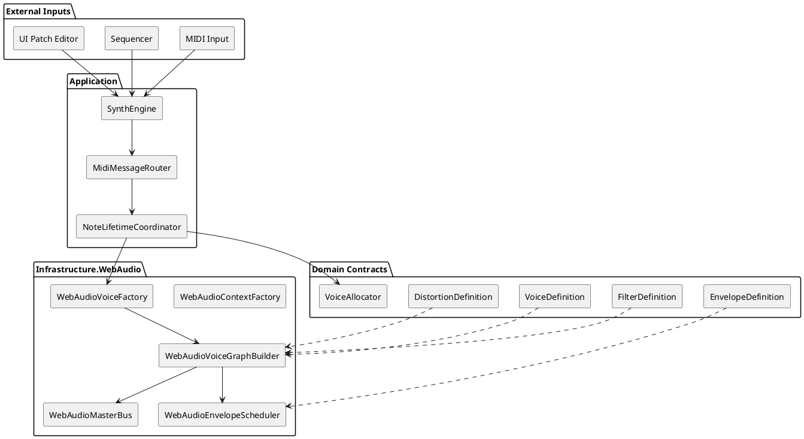
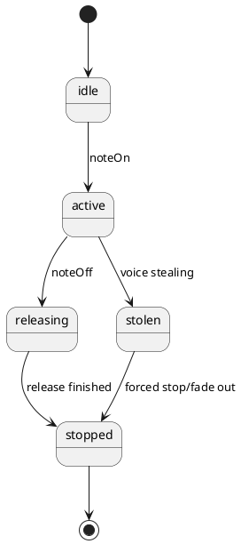

# SPEC-1-Web-Audio-Synthesizer-MVP

## Background

You want a production-ready MVP specification for a browser synthesizer using Web Audio as the sound engine. The synth must accept MIDI input, allocate polyphonic voices, build a per-voice audio graph, and connect modular sound components such as oscillators, optional noise, filters, distortion, ADSR envelope, and output gain.

The planned package set is a good start:

```text
modules
├── music-core-synthesizer-distortion
├── music-core-synthesizer-envelopes
├── music-core-synthesizer-filters
├── music-core-synthesizer-midi
├── music-core-synthesizer-noise
├── music-core-synthesizer-oscillators
├── music-core-synthesizer-voice
└── music-core-synthesizer-voiceAllocator
```

Best-guess adjustment: add a contracts package, a synth engine package, a VCA/gain package, a master bus package, and keep sequencing outside the synthesizer core.

Recommended production package layout:

```text
packages/Audio
├── music-core-midi                         # Existing MIDI value objects, parser, file reader
├── music-core-sequencer                    # Emits timed notes/control events; not synth-specific
├── music-core-transport                    # BPM, play/stop, lookahead scheduling clock
├── music-core-synthesizer-contracts        # Shared interfaces and definitions
├── music-core-synthesizer-engine           # SynthEngine, routing, note lifecycle
├── music-core-synthesizer-oscillators      # Oscillator definitions and validation
├── music-core-synthesizer-noise            # Noise definitions and validation
├── music-core-synthesizer-filters          # LP/BP/HP filter definitions
├── music-core-synthesizer-distortion       # Distortion definitions and curve helpers
├── music-core-synthesizer-envelopes        # ADSR definitions and envelope math
├── music-core-synthesizer-vca              # Gain/VCA definitions
├── music-core-synthesizer-voice            # Runtime voice object and lifecycle
├── music-core-synthesizer-voice-allocator  # Polyphony and stealing policy
├── music-core-synthesizer-presets          # Patch serialization/versioning
└── music-infra-webaudio-synthesizer        # WebAudio implementations/factories

packages/UI
├── music-ui-synthesizer                    # Full synth component
├── music-ui-synthesizer-oscillators        # Optional reusable UI controls
├── music-ui-synthesizer-envelopes
├── music-ui-synthesizer-filters
├── music-ui-synthesizer-distortion
└── music-ui-sequencer
```

UI components should not live inside the audio core packages. Keep audio packages pure TypeScript with no React dependency. UI packages can depend on the contracts and send patch/control updates to the engine.

## Requirements

### Must have

* Accept MIDI note-on and note-off messages from the existing `music-core-midi` package.
* Convert MIDI note number to oscillator frequency.
* Support at least one oscillator per voice.
* Support waveform selection: `sine`, `square`, `sawtooth`, `triangle`.
* Support ADSR amplitude envelope.
* Support distortion amount in normalized range `[-1..1]`.
* Support at least `lowpass`, `highpass`, and `bandpass` filters.
* Support polyphony through a voice allocator.
* Build a deterministic per-voice Web Audio graph.
* Expose a stable contracts package so modules can work together.
* Keep domain definitions independent from Web Audio implementation details where practical.

### Should have

* Optional noise source mixed with oscillator signal.
* Master output bus with gain and safety limiting/clipping strategy.
* Patch/preset object that can be serialized as JSON.
* Voice stealing policy: oldest, quietest, or released voice first.
* Note lifetime coordinator that maps `noteOn` / `noteOff` to voice start/release.
* Parameter validation for all ranges.

### Could have

* Multiple oscillators per voice with detune and gain per oscillator.
* Filter envelope.
* LFO modulation.
* Portamento/glide.
* Pitch bend and modulation wheel support.
* AudioWorklet-based custom DSP later.
* Stereo panning.
* Effects after the voice mixer: delay, chorus, reverb.

### Won't have in MVP

* Full modular patch-cable editor.
* Sample playback.
* Wavetable editor.
* MPE/polyphonic expression.
* Offline rendering/export.
* DAW-grade automation lanes.

## Method

### Architecture decision

Use an **Audio Graph Builder + Strategy + Facade** design.

* **Audio Graph Builder**: creates and connects Web Audio nodes for each voice.
* **Strategy**: oscillator, filter, distortion, envelope, and voice allocation behavior are selected through definitions/interfaces.
* **Facade**: `SynthEngine` is the simple public API for UI, sequencer, and MIDI input.

Do not make every module manually call the next module. In Web Audio, the real pipeline is the audio routing graph. Your application should build that graph from typed definitions.

Recommended MVP signal path:

```text
MIDI / Sequencer
   ↓
SynthEngine
   ↓
MidiMessageRouter
   ↓
NoteLifetimeCoordinator
   ↓
VoiceAllocator
   ↓
WebAudioVoiceFactory
   ↓
Per Voice Graph:
Oscillator(s)
   ↓
[Optional Noise Mix]
   ↓
Filter: LP / HP / BP
   ↓
Distortion: WaveShaper
   ↓
VCA: GainNode controlled by ADSR
   ↓
MasterBus
   ↓
AudioContext.destination
```

The VCA/gain module is required. The ADSR envelope does not produce sound by itself; it controls the VCA gain over time.

### Module responsibilities

| Package                                  | Responsibility                                                              |
| ---------------------------------------- | --------------------------------------------------------------------------- |
| `music-core-synthesizer-contracts`       | Shared definitions and interfaces. All other synth packages depend on this. |
| `music-core-synthesizer-engine`          | Public `SynthEngine`, MIDI routing, note lifecycle orchestration.           |
| `music-core-synthesizer-oscillators`     | Waveform, frequency, detune, oscillator validation.                         |
| `music-core-synthesizer-noise`           | Optional white/pink/brown noise definitions.                                |
| `music-core-synthesizer-filters`         | LP/HP/BP filter definitions: cutoff, resonance/Q, gain where relevant.      |
| `music-core-synthesizer-distortion`      | Distortion amount `[-1..1]`, curve algorithm, wet/dry later.                |
| `music-core-synthesizer-envelopes`       | ADSR definitions and validation.                                            |
| `music-core-synthesizer-vca`             | Amplitude gain definition. Runtime VCA is usually Web Audio `GainNode`.     |
| `music-core-synthesizer-voice`           | Runtime voice state: note, channel, started/released/stopped.               |
| `music-core-synthesizer-voice-allocator` | Polyphony limit and voice stealing policy.                                  |
| `music-core-synthesizer-presets`         | Patch save/load/version migration.                                          |
| `music-core-sequencer`                   | Timeline step/pattern playback. Emits scheduled MIDI/control events.        |
| `music-core-transport`                   | BPM, clock, lookahead scheduling, play/stop state.                          |
| `music-infra-webaudio-synthesizer`       | Actual Web Audio factories/builders/schedulers.                             |
| `music-ui-*`                             | React/Vue/etc. UI controls. No DSP logic.                                   |

### Sequencer location

Place the sequencer in:

```text
packages/Audio/music-core-sequencer
```

or, if you want it strongly tied to MIDI:

```text
packages/Audio/music-core-midi-sequencer
```

Best guess: use `music-core-sequencer` and let it emit `TimedSynthEvent` or `TimedMidiMessage`. This keeps it usable for synths, samplers, drum machines, and future external MIDI output.

The sequencer should not be under `music-core-synthesizer-*` because sequencing is not a synth voice concern.

### Component diagram



### Voice lifecycle



### Web Audio implementation notes

* Oscillator source: `OscillatorNode`.
* Noise source: generated `AudioBufferSourceNode` or later `AudioWorkletNode`.
* Filter: `BiquadFilterNode` with type `lowpass`, `highpass`, or `bandpass`.
* Distortion: `WaveShaperNode`.
* VCA/envelope: `GainNode.gain` scheduled by ADSR.
* Master output: `GainNode` and optional safety limiter/clamp later.
* Node connection should be handled by `WebAudioVoiceGraphBuilder`, not by individual domain modules.

### Minimal contracts code

```ts
// packages/Audio/music-core-synthesizer-contracts/src/index.ts

import type { MidiMessage } from "@monorepo/music-core-midi";

export type Seconds = number;
export type Hertz = number;
export type MidiNoteNumber = number; // 0..127
export type MidiChannelNumber = number; // 1..16 for public API
export type Velocity = number; // 0..127
export type Normalized01 = number; // 0..1
export type Bipolar = number; // -1..1
export type VoiceId = string;
export type PatchId = string;
export type AudioTime = number; // AudioContext.currentTime seconds

export type OscillatorWaveform = "sine" | "square" | "sawtooth" | "triangle";
export type FilterType = "lowpass" | "highpass" | "bandpass";
export type NoiseType = "white" | "pink" | "brown";
export type VoiceStealingPolicy = "oldest" | "released-first" | "quietest";

export interface IOscillatorDefinition {
  readonly id: string;
  readonly waveform: OscillatorWaveform;
  readonly gain: Normalized01;
  readonly octaveOffset?: number;
  readonly semitoneOffset?: number;
  readonly detuneCents?: number;
}

export interface INoiseDefinition {
  readonly enabled: boolean;
  readonly type: NoiseType;
  readonly gain: Normalized01;
}

export interface IEnvelopeDefinition {
  readonly attackSeconds: Seconds;
  readonly decaySeconds: Seconds;
  readonly sustainLevel: Normalized01;
  readonly releaseSeconds: Seconds;
}

export interface IFilterDefinition {
  readonly enabled: boolean;
  readonly type: FilterType;
  readonly cutoffHz: Hertz;
  readonly q: number;
  readonly gainDb?: number;
}

export interface IDistortionDefinition {
  readonly enabled: boolean;
  /** -1..1. Sign may select curve polarity/asymmetry; abs(amount) is drive. */
  readonly amount: Bipolar;
  readonly oversample?: "none" | "2x" | "4x";
}

export interface IVcaDefinition {
  readonly gain: Normalized01;
  readonly ampEnvelope: IEnvelopeDefinition;
}

export interface IVoiceDefinition {
  readonly id: string;
  readonly oscillators: readonly IOscillatorDefinition[];
  readonly noise?: INoiseDefinition;
  readonly filter?: IFilterDefinition;
  readonly distortion?: IDistortionDefinition;
  readonly vca: IVcaDefinition;
}

export interface ISynthPatch {
  readonly id: PatchId;
  readonly name: string;
  readonly version: 1;
  readonly voice: IVoiceDefinition;
  readonly polyphony: number;
  readonly voiceStealing: VoiceStealingPolicy;
  readonly masterGain: Normalized01;
}

export interface INoteOnCommand {
  readonly type: "noteOn";
  readonly channel: MidiChannelNumber;
  readonly note: MidiNoteNumber;
  readonly velocity: Velocity;
  readonly time?: AudioTime;
}

export interface INoteOffCommand {
  readonly type: "noteOff";
  readonly channel: MidiChannelNumber;
  readonly note: MidiNoteNumber;
  readonly velocity?: Velocity;
  readonly time?: AudioTime;
}

export interface IAllNotesOffCommand {
  readonly type: "allNotesOff";
  readonly time?: AudioTime;
}

export interface IPatchChangeCommand {
  readonly type: "patchChange";
  readonly patch: ISynthPatch;
  readonly time?: AudioTime;
}

export type SynthCommand =
  | INoteOnCommand
  | INoteOffCommand
  | IAllNotesOffCommand
  | IPatchChangeCommand;

export interface ITimedSynthCommand<TCommand extends SynthCommand = SynthCommand> {
  readonly at: AudioTime;
  readonly command: TCommand;
}

export interface IMidiMessageRouter {
  toSynthCommand(message: MidiMessage, receivedAt?: AudioTime): SynthCommand | null;
}

export interface IVoice {
  readonly id: VoiceId;
  readonly channel: MidiChannelNumber;
  readonly note: MidiNoteNumber;
  readonly startedAt: AudioTime;
  readonly releasedAt?: AudioTime;
  start(time: AudioTime): void;
  release(time: AudioTime): void;
  stop(time: AudioTime): void;
  isActive(): boolean;
  isReleased(): boolean;
}

export interface IVoiceAllocator {
  allocate(input: {
    readonly activeVoices: readonly IVoice[];
    readonly channel: MidiChannelNumber;
    readonly note: MidiNoteNumber;
    readonly time: AudioTime;
    readonly patch: ISynthPatch;
  }): { readonly reusableVoice?: IVoice; readonly voiceToSteal?: IVoice };
}

export interface IVoiceFactory {
  createVoice(input: {
    readonly channel: MidiChannelNumber;
    readonly note: MidiNoteNumber;
    readonly velocity: Velocity;
    readonly frequencyHz: Hertz;
    readonly patch: ISynthPatch;
    readonly destination: unknown;
  }): IVoice;
}

export interface IEnvelopeScheduler<TParam = unknown> {
  scheduleAttackDecaySustain(input: {
    readonly param: TParam;
    readonly envelope: IEnvelopeDefinition;
    readonly peak: Normalized01;
    readonly startTime: AudioTime;
  }): void;

  scheduleRelease(input: {
    readonly param: TParam;
    readonly envelope: IEnvelopeDefinition;
    readonly releaseStartTime: AudioTime;
  }): AudioTime;
}

export interface IAudioPipelineNode<TNativeNode = unknown> {
  readonly id: string;
  readonly native: TNativeNode;
  connect(destination: IAudioPipelineNode<TNativeNode> | TNativeNode): void;
  disconnect(): void;
}

export interface IVoiceGraph<TNativeNode = unknown> {
  readonly voice: IVoice;
  readonly inputNodes: readonly IAudioPipelineNode<TNativeNode>[];
  readonly outputNode: IAudioPipelineNode<TNativeNode>;
  readonly vcaGainParam: unknown;
  dispose(): void;
}

export interface IVoiceGraphBuilder<TNativeNode = unknown> {
  build(input: {
    readonly voice: IVoice;
    readonly patch: ISynthPatch;
    readonly frequencyHz: Hertz;
    readonly velocity: Velocity;
    readonly destination: TNativeNode;
  }): IVoiceGraph<TNativeNode>;
}

export interface IMasterBus<TDestination = unknown> {
  readonly input: TDestination;
  readonly output: TDestination;
  setGain(gain: Normalized01, time?: AudioTime): void;
  connect(destination: TDestination): void;
  disconnect(): void;
}

export interface ISynthEngine {
  readonly currentPatch: ISynthPatch;
  loadPatch(patch: ISynthPatch): void;
  handleMidi(message: MidiMessage, receivedAt?: AudioTime): void;
  dispatch(command: SynthCommand): void;
  schedule(commands: readonly ITimedSynthCommand[]): void;
  allNotesOff(time?: AudioTime): void;
  dispose(): void;
}

export interface ISequencer {
  load(commands: readonly ITimedSynthCommand[]): void;
  start(startAt?: AudioTime): void;
  stop(stopAt?: AudioTime): void;
  setLoop(enabled: boolean): void;
  connect(sink: Pick<ISynthEngine, "dispatch" | "schedule">): void;
}

export function midiNoteToFrequencyHz(note: MidiNoteNumber, a4Hz = 440): Hertz {
  return a4Hz * Math.pow(2, (note - 69) / 12);
}
```

### Default MVP patch

```json
{
  "id": "basic-saw-lead",
  "name": "Basic Saw Lead",
  "version": 1,
  "polyphony": 8,
  "voiceStealing": "released-first",
  "masterGain": 0.8,
  "voice": {
    "id": "basic-voice",
    "oscillators": [
      { "id": "osc1", "waveform": "sawtooth", "gain": 0.8, "detuneCents": 0 }
    ],
    "noise": { "enabled": false, "type": "white", "gain": 0 },
    "filter": { "enabled": true, "type": "lowpass", "cutoffHz": 8000, "q": 0.7 },
    "distortion": { "enabled": true, "amount": 0.2, "oversample": "2x" },
    "vca": {
      "gain": 0.9,
      "ampEnvelope": {
        "attackSeconds": 0.01,
        "decaySeconds": 0.15,
        "sustainLevel": 0.7,
        "releaseSeconds": 0.25
      }
    }
  }
}
```

## Implementation

### Step 1: Create the contracts package

Create:

```text
packages/Audio/music-core-synthesizer-contracts/src/index.ts
```

Add the contract code from the Method section. All synth packages should depend on this package, not on each other directly.

### Step 2: Implement validation in each core module

Each module should export definition factories, validation, and defaults only.

Example responsibility split:

```text
music-core-synthesizer-oscillators
- createOscillatorDefinition()
- validateOscillatorDefinition()
- DEFAULT_OSCILLATOR

music-core-synthesizer-envelopes
- createAdsrEnvelope()
- validateEnvelopeDefinition()
- DEFAULT_AMP_ENVELOPE

music-core-synthesizer-filters
- createFilterDefinition()
- validateFilterDefinition()
- DEFAULT_FILTER
```

### Step 3: Implement Web Audio infrastructure

Create:

```text
packages/Audio/music-infra-webaudio-synthesizer
```

Implement:

* `WebAudioContextFactory`
* `WebAudioMasterBus`
* `WebAudioVoiceFactory`
* `WebAudioVoiceGraphBuilder`
* `WebAudioEnvelopeScheduler`
* `WebAudioNoiseSourceFactory`

The graph builder owns the Web Audio connection order:

```text
oscillatorGainMixer
  -> optional filter
  -> optional distortion
  -> vcaGain
  -> masterBus.input
```

### Step 4: Implement voice lifecycle

`WebAudioVoice` should:

* create/start source nodes on `start(time)`;
* schedule ADSR attack/decay/sustain at `start(time)`;
* schedule ADSR release at `release(time)`;
* stop and disconnect source nodes after release ends;
* support `stop(time)` for stealing/all-notes-off.

### Step 5: Implement SynthEngine

`SynthEngine` should be the only object called directly by UI, MIDI input, and sequencer.

Responsibilities:

* hold current patch;
* route MIDI to synth commands;
* calculate frequency from MIDI note;
* ask allocator for available voice slot;
* create/release/steal voices;
* schedule commands using Web Audio time;
* expose `allNotesOff()` and `dispose()`.

### Step 6: Implement sequencer separately

Create:

```text
packages/Audio/music-core-sequencer
```

The sequencer should not know how oscillators or filters work. It only emits timed commands:

```text
[{ at: 0.0, command: noteOn C4 }, { at: 0.25, command: noteOff C4 }]
```

Later, it can parse your existing `MidiStringParser` output into timed note events.

### Step 7: Implement UI packages after the engine works

Do not start with UI. First prove sound generation with a small test harness:

1. Create `AudioContext`.
2. Create `SynthEngine`.
3. Load default patch.
4. Dispatch `noteOn` for MIDI note 60.
5. Dispatch `noteOff` after 500 ms.

Then add UI controls for patch editing.

## Milestones

### Milestone 1: Sound proof

* Contracts package compiles.
* WebAudio context factory works.
* One oscillator plays one note.
* `midiNoteToFrequencyHz(69)` returns `440`.

### Milestone 2: Voice graph MVP

* Per-voice graph supports oscillator → filter → distortion → VCA → master.
* ADSR starts and releases without clicks.
* One patch object controls the graph.

### Milestone 3: MIDI integration

* Existing `MidiMessage` routes to `noteOn` / `noteOff` commands.
* Note-on creates voice.
* Note-off releases matching voice.

### Milestone 4: Polyphony

* Voice allocator supports configurable polyphony.
* Released voices are reused or removed.
* Voice stealing works when polyphony limit is reached.

### Milestone 5: Sequencer

* `music-core-sequencer` schedules timed synth commands.
* Existing `MidiStringParser` can be adapted into sequencer events.
* Sequencer can drive `SynthEngine` without depending on Web Audio internals.

### Milestone 6: UI

* Patch editor updates oscillator, filter, envelope, distortion, and master gain.
* UI packages depend on contracts and engine, not Web Audio node internals.

## Gathering Results

Evaluate the MVP using these checks:

* Notes start within acceptable latency after `noteOn`.
* Notes release cleanly after `noteOff`.
* No stuck notes after rapid input or `allNotesOff()`.
* Polyphony limit is respected.
* Voice stealing does not create loud clicks.
* Filter type changes produce expected LP/BP/HP behavior.
* Distortion amount `0` is effectively clean, positive/negative values are deterministic.
* Sequencer timing stays stable over repeated loops.
* Patch JSON can be saved and loaded without runtime-specific objects.
* Core packages can run unit tests without a browser.

Suggested automated tests:

* MIDI note to frequency conversion.
* ADSR validation and release-end time calculation.
* Voice allocator behavior for all policies.
* Patch schema validation.
* MIDI router maps note-on velocity `0` to note-off.
* Sequencer converts parsed steps into ordered timed commands.

## Need Professional Help in Developing Your Architecture?

Please contact me at [sammuti.com](https://sammuti.com) :)
