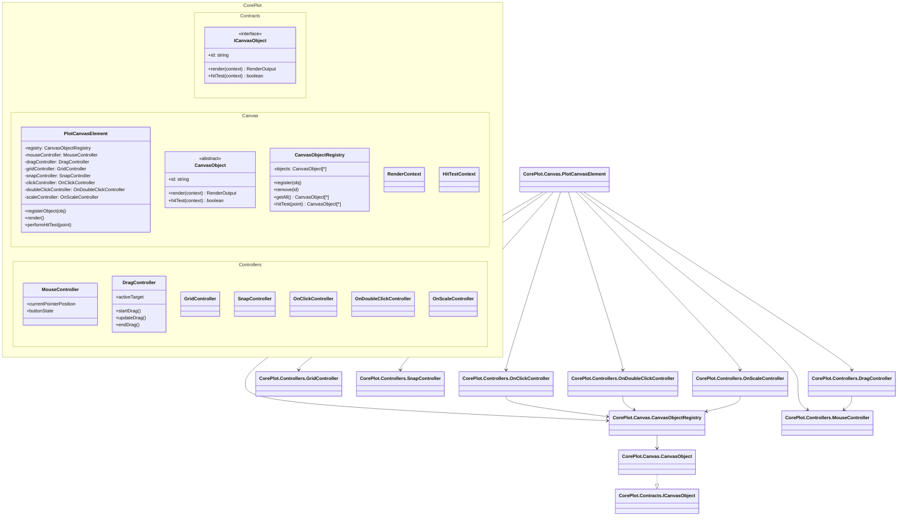
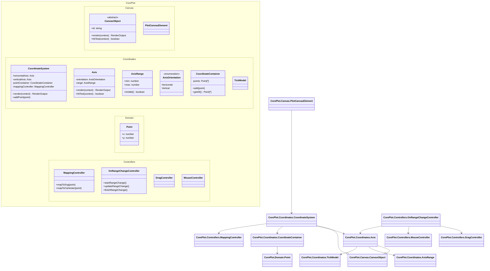
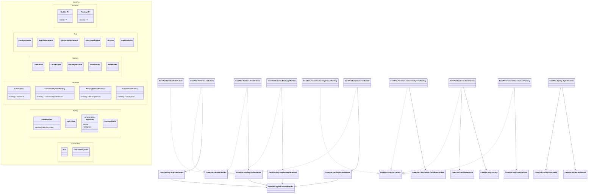
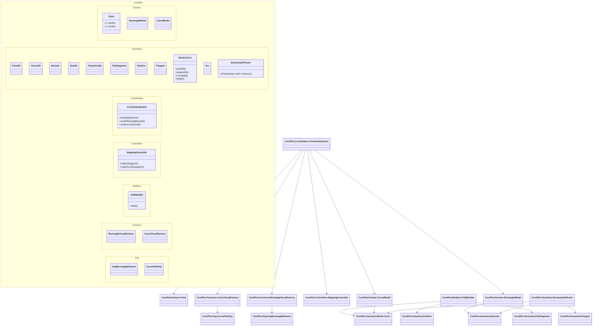

# `@monorepo/core-plot`

## Sprint Class Diagrams

This document provides one class diagram per sprint.

It is intended to sit with the specification set and support staged implementation from:

* `master.spsification.txt`
* `backlog.4-sprints.md`
* `technical-implementation-plan.md`

---

# Sprint 1: Canvas Foundation

## Scope

This sprint establishes:

* the composition root
* canvas object registration
* rendering
* hit testing
* core interaction controllers

---

# Sprint 2: Coordinate System Core

## Scope

This sprint introduces:

* `CoordinateSystem`
* `Axis`
* `Point` as a domain object
* `MappingController`
* axis range interaction

---

# Sprint 3: SVG Composition and Styling

## Scope

This sprint standardizes:

* primitive SVG components
* builders
* factories
* token-based styling
* composition rules

---

# Sprint 4: Geometry and Advanced Plotting

## Scope

This sprint adds:

* interpolation
* rectangles
* reusable geometry types
* geometry-driven hit testing

---

# Recommended Usage

Use these diagrams together:

* Sprint 1 diagram for platform and controller wiring
* Sprint 2 diagram for coordinate-system implementation
* Sprint 3 diagram for rendering architecture and styling
* Sprint 4 diagram for geometry and advanced plotting

If you want, I can also convert these into:

* PlantUML
* one image per sprint
* one consolidated namespace diagram for the whole product
