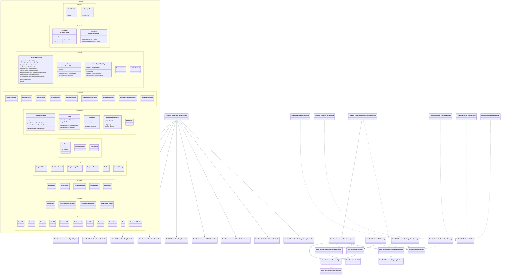

# `@monorepo/core-plot`

## Technical Implementation Plan

This document describes how to implement the plotting system using:

* Lit 3
* SVG
* Web Components
* Reactive Controllers
* Namespace-based packaging for visibility and discoverability

It is aligned with:

* `master.spsification.txt`

---

# 1. Implementation Intent

The system should be built as a layered plotting platform where:

* `PlotCanvasElement` is the composition root
* `CanvasObject` is the core render and hit-test contract
* domain data stays independent from rendering
* interaction behavior lives in Lit reactive controllers
* SVG primitives are the only rendering mechanism
* composition is preferred over inheritance

The implementation should optimize for:

* deterministic rendering
* low coupling
* extension by addition
* controlled LitElement count
* explicit object graph creation

---

# 2. Recommended Product Structure

Use namespaces at the TypeScript level for product visibility and mental grouping, while keeping file-level modules for actual code organization.

Recommended root namespace:

* `CorePlot`

Recommended namespace breakdown:

* `CorePlot.Patterns`
* `CorePlot.Lit`
* `CorePlot.Canvas`
* `CorePlot.Controllers`
* `CorePlot.Coordinates`
* `CorePlot.Domain`
* `CorePlot.Svg`
* `CorePlot.Geometry`
* `CorePlot.Styling`
* `CorePlot.Factories`
* `CorePlot.Builders`
* `CorePlot.Contracts`

This gives a visible product map without collapsing everything into one large module.

---

# 3. Namespace Model

## 3.1 `CorePlot.Patterns`

Purpose:

* shared design-pattern abstractions
* builder and factory contracts
* composition-root conventions

Contains:

* `Builder<T>`
* `Factory<T>`
* `CompositionRoot`
* `RenderStrategy` only if genuinely needed later

## 3.2 `CorePlot.Lit`

Purpose:

* Lit-specific infrastructure
* base controller helpers
* template utilities

Contains:

* `ReactiveControllerHostAdapter`
* `ControllerRegistrar`
* `SvgTemplateComposer`

## 3.3 `CorePlot.Canvas`

Purpose:

* top-level plotting surface
* canvas render lifecycle
* object registration
* hit-test routing

Contains:

* `PlotCanvasElement`
* `CanvasObject`
* `CanvasObjectRegistry`
* `RenderContext`
* `HitTestContext`
* `CanvasScene`

## 3.4 `CorePlot.Controllers`

Purpose:

* behavior isolation
* user interaction logic

Contains:

* `MouseController`
* `DragController`
* `GridController`
* `SnapController`
* `OnClickController`
* `OnDoubleClickController`
* `OnScaleController`
* `OnRangeChangeController`
* `MappingController`

## 3.5 `CorePlot.Coordinates`

Purpose:

* Cartesian plotting system
* mapping-aware rendering

Contains:

* `CoordinateSystem`
* `Axis`
* `AxisRange`
* `AxisOrientation`
* `TickModel`
* `CoordinateContainer`

## 3.6 `CorePlot.Domain`

Purpose:

* pure plotting data
* no rendering behavior

Contains:

* `Point`
* `RectangleModel`
* `CurveModel`

## 3.7 `CorePlot.Svg`

Purpose:

* primitive SVG web components
* composed SVG template parts

Contains:

* `SvgLineElement`
* `SvgCircleElement`
* `SvgRectangleElement`
* `SvgArrowElement`
* `TickSvg`
* `CurvePathSvg`

## 3.8 `CorePlot.Geometry`

Purpose:

* reusable geometry and hit-testing model

Contains:

* `Point2D`
* `Vector2D`
* `Bounds`
* `Size2D`
* `Transform2D`
* `PathSegment`
* `Polyline`
* `Polygon`
* `BezierCurve`
* `Arc`
* `GeometryHitTester`

## 3.9 `CorePlot.Styling`

Purpose:

* token-based visual styling

Contains:

* `StyleToken`
* `StyleState`
* `StyleResolver`
* `SvgStyleModel`

## 3.10 `CorePlot.Factories`

Purpose:

* composition of higher-level visual objects

Contains:

* `AxisFactory`
* `CoordinateSystemFactory`
* `RectangleVisualFactory`
* `CurveVisualFactory`

## 3.11 `CorePlot.Builders`

Purpose:

* primitive object creation with invariant control

Contains:

* `LineBuilder`
* `CircleBuilder`
* `RectangleBuilder`
* `ArrowBuilder`
* `PathBuilder`

## 3.12 `CorePlot.Contracts`

Purpose:

* interfaces and narrow public contracts

Contains:

* `ICanvasObject`
* `IRenderContext`
* `IHitTestContext`
* `IMappingController`
* `IAxisObject`
* `ISvgPrimitive`

---

# 4. Core Implementation Approach

## 4.1 Lit 3 usage

Use Lit only where it provides concrete value:

* `PlotCanvasElement` should be a LitElement
* primitive SVG elements may be Lit components
* composite structures should prefer templates instead of one LitElement per part

Do not make every plotted concept a web component.

The target model should be:

* few host elements
* many plain classes
* reactive controllers for behavior
* template-driven SVG composition

## 4.2 SVG rendering model

The `<svg>` root should be owned by `PlotCanvasElement`.

Inside that root:

* grid background
* coordinate system visuals
* mapped point visuals
* rectangles
* curves
* interaction overlays

`CanvasObject.render(...)` should produce SVG template output or a render model consumable by templates.

Recommended direction:

* use plain classes for scene objects
* convert them into SVG templates during canvas render

That keeps the object model separate from web-component count.

## 4.3 State model

State should be split into:

* canvas state
* interaction state
* domain state
* derived render state

Only source-of-truth state should be mutable.

Derived SVG positions should be recomputed from:

* domain coordinates
* axis ranges
* viewport bounds

## 4.4 Interaction model

All user interaction should be routed like this:

1. native pointer event reaches `PlotCanvasElement`
2. `MouseController` normalizes it
3. `DragController` derives drag lifecycle if needed
4. semantic controllers consume normalized state
5. domain or canvas objects are updated through explicit contracts
6. Lit schedules rerender

This keeps DOM events out of domain and rendering code.

---

# 5. Recommended Design Patterns

## 5.1 Composition Root

Use:

* `PlotCanvasElement` as the composition root for the runtime graph

Responsibilities:

* create controllers
* create registry
* host SVG root
* orchestrate render cycle

## 5.2 Registry Pattern

Use:

* `CanvasObjectRegistry`

Responsibilities:

* register objects
* preserve deterministic order
* provide hit-test traversal order

## 5.3 Builder Pattern

Use builders only for:

* SVG primitives
* path construction
* objects with staged invariant-safe construction

Do not use builders for trivial domain objects like `Point`.

## 5.4 Factory Pattern

Use factories for:

* axis composition
* coordinate system visuals
* rectangle visuals
* curve visuals

Factories should assemble objects, not own runtime behavior.

## 5.5 Strategy Pattern

Use only where variability is expected, such as:

* interpolation algorithm selection
* hit-testing policy
* snapping policy

Do not introduce strategy abstractions before there is more than one real policy.

## 5.6 Value Object Pattern

Use value objects for:

* `AxisRange`
* `Bounds`
* `Size2D`
* `Transform2D`

These should enforce invariants and avoid magic tuples spread throughout the code.

## 5.7 Template Composition

Use Lit templates to compose:

* axis visuals
* coordinate system visuals
* point visuals
* overlay visuals

This is preferred over creating one web component per tiny sub-part.

---

# 6. Class Diagram



---

# 7. Rendering Flow

## 7.1 Render sequence

Recommended render pipeline:

1. `PlotCanvasElement.render()` creates root `<svg>`
2. `GridController` contributes background grid template
3. `CanvasObjectRegistry` returns objects in deterministic order
4. each `CanvasObject` contributes render output
5. composed outputs are merged into the final SVG template
6. overlay and interaction visuals are rendered last

## 7.2 Coordinate mapping flow

Recommended coordinate flow:

1. source domain data exists in Cartesian form
2. `AxisRange` defines current visible domain
3. `MappingController` transforms Cartesian to SVG
4. factories or template composers create visual fragments
5. Lit renders those fragments inside the SVG root

---

# 8. Package and File Structure

Recommended folder structure:

```text
src/
  master.spsification.txt
  technical-implementation-plan.md
  canvas/
    plot-canvas-element.ts
    canvas-object.ts
    canvas-object-registry.ts
    render-context.ts
    hit-test-context.ts
  controllers/
    mouse-controller.ts
    drag-controller.ts
    grid-controller.ts
    snap-controller.ts
    on-click-controller.ts
    on-double-click-controller.ts
    on-scale-controller.ts
    on-range-change-controller.ts
    mapping-controller.ts
  coordinates/
    coordinate-system.ts
    axis.ts
    axis-range.ts
    axis-orientation.ts
    tick-model.ts
    coordinate-container.ts
  domain/
    point.ts
    rectangle-model.ts
    curve-model.ts
  svg/
    primitives/
      svg-line-element.ts
      svg-circle-element.ts
      svg-rectangle-element.ts
      svg-arrow-element.ts
    composed/
      tick-svg.ts
      curve-path-svg.ts
  geometry/
    point2d.ts
    vector2d.ts
    bounds.ts
    size2d.ts
    transform2d.ts
    path-segment.ts
    polyline.ts
    polygon.ts
    bezier-curve.ts
    arc.ts
    geometry-hit-tester.ts
  factories/
    axis-factory.ts
    coordinate-system-factory.ts
    rectangle-visual-factory.ts
    curve-visual-factory.ts
  builders/
    line-builder.ts
    circle-builder.ts
    rectangle-builder.ts
    arrow-builder.ts
    path-builder.ts
  styling/
    style-state.ts
    style-token.ts
    style-resolver.ts
    svg-style-model.ts
  contracts/
    i-canvas-object.ts
    i-mapping-controller.ts
```

Use barrel files sparingly.

Prefer narrow exports over large wildcard export surfaces.

---

# 9. Implementation Phases

## Phase 1: Runtime foundation

Build:

* `PlotCanvasElement`
* `CanvasObject`
* `CanvasObjectRegistry`
* render and hit-test contexts
* core interaction controller wiring

## Phase 2: Coordinate system

Build:

* `CoordinateSystem`
* `Axis`
* `AxisRange`
* `CoordinateContainer`
* `Point`
* `MappingController`

## Phase 3: SVG architecture

Build:

* SVG primitives
* factories
* builders
* token-driven style resolver

## Phase 4: Advanced geometry

Build:

* curve interpolation support
* rectangles
* geometry subsystem
* geometry-based hit testing

---

# 10. Critical Technical Decisions

## Decision 1

Use plain classes for most runtime objects, not web components.

Reason:

* lower runtime cost
* clearer separation of concerns
* easier testing

## Decision 2

Use one host SVG root in `PlotCanvasElement`.

Reason:

* central render orchestration
* easier z-order control
* easier hit-testing coordination

## Decision 3

Keep `Point` as a domain object only.

Reason:

* removes rendering responsibility from pure data
* keeps mapping and visual generation inside the coordinate system

## Decision 4

Use reactive controllers for all behavior concerns.

Reason:

* aligns with Lit 3
* keeps host element simpler
* prevents interaction logic from leaking into rendering code

## Decision 5

Use namespace names for architecture visibility, but implement through file modules.

Reason:

* keeps modern TypeScript tooling practical
* still gives the product a readable architectural map

---

# 11. Recommendation

The best implementation shape is:

* one Lit-based canvas host
* plain class domain and canvas objects
* reactive controllers for behavior
* SVG template composition for visuals
* factories for composed visuals
* builders only for primitives and paths
* namespaces used as documentation and API grouping, not as a replacement for file-level modules

If you want, the next useful artifact is a stricter version of this plan as:

* a PlantUML class diagram
* TypeScript interface contracts
* a file-by-file scaffold plan
